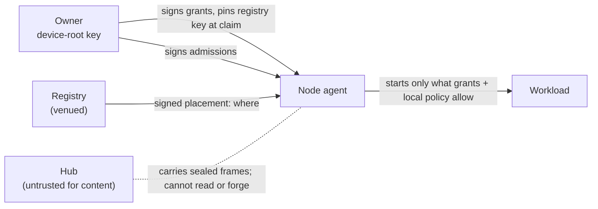

# 2. Architecture

> [!info] State
> The layering is settled. The node runtime and placement path are **Partial** (one node, compose bundle). The node contract is **Draft**.

![[benixos-system-architecture.svg]]

## The layers

| Layer | What lives here | Chapter |
|---|---|---|
| **Applications** | Courier, household services (Jellyfin, Home Assistant, Pi-hole, Frigate), automation, operator tools | 12 |
| **Kits** | The framework layer: one Kit per domain | 4 |
| **System servers** | `venued`, the node agent, the gateway, glues, claim and discovery | 5, 6, 8 |
| **Node contract and wire** | Hearth, namespace ops, the node contract, capability grants | 3, 7 |
| **Node runtime** | libbenix, dockerd and containers, local bus | 11 |
| **Hosts** | DeviceNix, Ubuntu/Debian, macOS, Windows | 11 |
| **Hardware** | Thunderhead Aether (Pi 5 / CM5), Forge (AMD64) | 11 |

The Android comparison is useful for the shape and misleading in two places. **Hosts are plural**: there is no single kernel at the bottom, only "any host that meets the node contract". And **placement has no Android counterpart**: deciding which node runs a workload, and having that node independently decide whether to, is the distributed part.

## Three planes

The design separates three jobs that are easy to blur.

| Plane | Job | Owner |
|---|---|---|
| **Control** | Decide *where* work may run: registry, planner, leases | **Venue** (`venued`) |
| **Enforcement** | Decide *whether* it runs, from owner-signed grants and local policy | **The node agent** (the executor) |
| **Wire** | Carry messages between nodes, with identity, sealing and ordering | **Hearth**, via Message Kit and Fabric Kit |

> [!important] The central rule
> **A placement is not an authorization.** Venue decides where; the node agent independently decides whether. A placement with no covering grant is refused. (Node contract §5.1.)

This is why the node agent is a separate process from the registry, and why the registry holds no Docker socket. A compromised registry can ask for bad work; it cannot make a node do it.

## Who trusts whom

- **The owner** is the person whose key was pinned on the node at claim. Their key is the root of every offline check.
- **The registry** is trusted for *placement order*, not for authorization.
- **The hub** carries sealed payloads. The seal proves only "some household device", so the registry's signature goes *inside* the sealed payload (contract §9.3).
- **Keycloak** authenticates a human to the consent step. It is **never an input to a node's grant check** (contract §2.3).

## Where the code lives

| Area | Repo | Org |
|---|---|---|
| Wire spec | `hearth` | slash-builder |
| Kits (one repo each, except merged ones) | `message-kit`, `fabric-kit`, `venue-kit`, `storage-kit`, … | slash-builder |
| System tree (new) | `benixos` (executor, compose bundle) | **benixos** org |
| Distribution prototype | `distribution` | benixos |
| Host distro | `core` (Yocto, `meta-benixos`) | slash-builder |
| Gateway and glue | `gateway`, `service-catalog` | slash-builder, private |
| Commercial operator | `hub`, `api`, `courier`, `identity-service` | quickring |

New system code goes in one monorepo, and existing system repos do not migrate yet. First-tier BenixOS repos live in the `benixos` GitHub organisation. Kits stay in `slash-builder`.

## Topology

The working design for several nodes is a **star**: one registry host, an executor on every node, nodes connect outbound only, mutual TLS on the one inbound port. It is built and reviewed only against a simulated cluster so far (chapter 6).

## Next

[3. Hearth](03-hearth.html)
