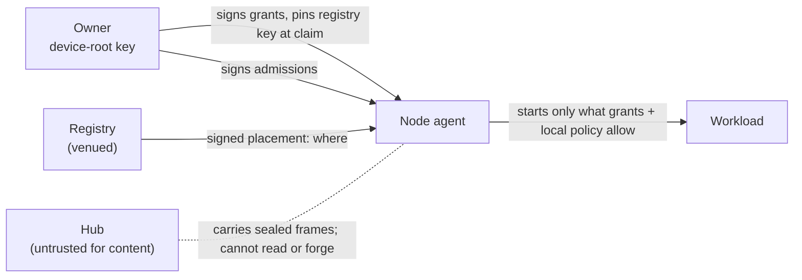

# 2. Architecture

> [!info] State
> The layering is settled. The node runtime and placement path are **Partial** (one node). The node contract is **Draft**.

## The layers

| Layer | What lives here | Chapter |
|---|---|---|
| **Applications** | Wasm components, ported containers, household services, automation, operator tools | 12 |
| **Kits** | The framework layer: one Kit per domain | 4 |
| **System servers** | The registry, the node agent, the loader, presenters, the signer, the gateway, glues, claim and discovery | 5, 6, 8, 13, 14 |
| **Node contract and wire** | Hearth, namespace operations, the node contract, capability grants | 3, 7 |
| **Node runtime** | `libbenix`, a container runtime, the local bus | 11 |
| **Hosts** | DeviceNix, Ubuntu and Debian, macOS, Windows | 11 |
| **Hardware** | Single-board and AMD64 reference hardware, generic PCs and VMs | 11 |

Two things differ from a conventional stack. **Hosts are plural:** there is no single kernel at the bottom, only "any host that meets the node contract". And **placement is its own concern:** deciding which node runs a workload, and having that node independently decide whether to, is the distributed part.

## Three planes

| Plane | Job | Owner |
|---|---|---|
| **Control** | Decide *where* work may run: registry, planner, leases | Venue (`venued`) |
| **Enforcement** | Decide *whether* it runs, from owner-signed grants and local policy | The node agent |
| **Wire** | Carry messages between nodes with identity, sealing and ordering | Hearth, through Message Kit and Fabric Kit |

> [!important] The central rule
> **A placement is not an authorization.** Venue decides where; the node agent independently decides whether. A placement with no covering grant is refused.

A compromised registry can ask for bad work. It cannot make a node do it. That is why the node agent is a separate process from the registry, and why the registry holds no Docker socket.

## Who trusts whom

- **The owner** is the person whose key was pinned on the node at claim. That key is the root of every offline check.
- **The registry** is trusted for placement order, not for authorization.
- **The hub** carries sealed payloads. The seal proves only "some household device", so the registry's signature goes inside the sealed payload.
- **An identity provider** authenticates a person to the consent step. It is never an input to a node's grant check.

## Interactive traffic

The hub is the signalling and low-rate control plane. **Interactive view traffic never rides the hub.** It takes a direct path: the local bus on the box, a peer link on the LAN, a WebRTC data channel across the WAN ([Presenters](13-presenters.html)).

## Topology

The design for several nodes is a **star**: one registry host, an executor on every node, outbound-only connections from the nodes, and mutual TLS on the single inbound port.

## Next

[3. Hearth](03-hearth.html)
