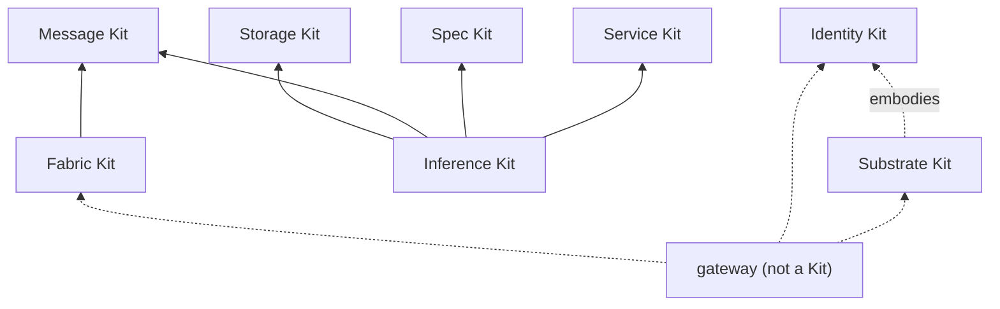

# 4. Kits

> [!info] State
> The Kit model is settled. **No Kit is `stable`.** Message Kit and Fabric Kit are `pre-release`; the rest are `alpha`.

A **Kit** is a focused library that owns one job and exposes an API other things build on. **Products compose Kits.** The dependency graph is acyclic. Kits are Rust, with a Flutter and Dart facade only where a UI platform needs one.

## When something becomes a Kit

A Kit is a **domain**, not a protocol or a feature. A new Kit needs:

1. two independent consumers,
2. an invariant no existing Kit holds, and
3. more than a module's worth of surface.

Anything that fails the test is a module of an existing Kit. Identity Kit holds `claim`, Fabric Kit holds `stream`, Substrate Kit holds `host`, and Interface Kit holds `mold`.

## Status vocabulary

Evidence is the test, not intent.

| Status | Means |
|---|---|
| `design` | A document; no code to speak of |
| `scaffold` | A skeleton nothing depends on |
| `alpha` | Real code and tests, no stable API |
| `pre-release` | Published, depended on, API settling |
| `stable` | API frozen with a versioning promise |

## The catalog

### Protocol

| Kit | Status | Job |
|---|---|---|
| **Message Kit** | pre-release | The Hearth envelope, the T/R/D grammar, the `RemoteTransport` trait, and the local `AF_UNIX SOCK_SEQPACKET` bus |
| **Fabric Kit** | pre-release | The Hearth SDK: pub/sub, pairing, family-graph client; module `stream` |
| **Spec Kit** | alpha | Conformance and spec primitives; the intended home of the Hearth and node conformance suites |

### Data and identity

| Kit | Status | Job |
|---|---|---|
| **Storage Kit** | alpha | Content-addressed storage: BLAKE3, chunking, Zstd packfiles, per-partition isolation |
| **Identity Kit** | alpha | `ServicePrincipal`, account and family types, an OIDC client; module `claim` |

### Placement and runtime

| Kit | Status | Job |
|---|---|---|
| **Venue Kit** | alpha | One registry and planner for every place work can run |
| **Errand Kit** | alpha | Gated, sandboxed agent runs: credentials dropped, verdict computed in code, hand-back waits for consent |
| **Substrate Kit** | alpha | Linux and dockerd lifecycle, cgroup, mount and principal layer; module `host` |
| **Service Kit** | alpha | `axum` and `tower` service foundation: metrics, structured errors, audit trail |

### Apps and interface

| Kit | Status | Job |
|---|---|---|
| **App Context Kit** | alpha | One spec and shared fixtures that a Dart and a Rust implementation both pass: an app's identity, directories, settings, roster presence, Venue session, peers |
| **Interface Kit** | alpha | Cross-platform UI patterns; module `mold` |
| **Work Strip Kit** | alpha | Workflow as one component; module `dispatcher` |

### Intelligence and build

| Kit | Status | Job |
|---|---|---|
| **Inference Kit** | alpha | Local-first, egress-gated inference orchestration |
| **Manifest Kit** | alpha | Generate operating systems from a manifest; build time only |

## Dependencies

Solid arrows are declared dependencies. Dotted arrows are consumption relationships. This is not a generated Cargo graph.

## Next

[5. Nodes](05-nodes.html)
