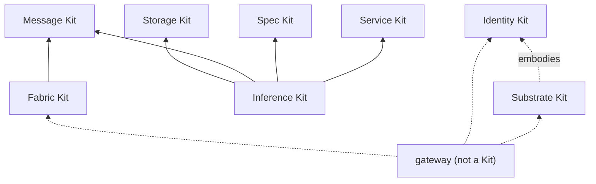

# 4. Kits

> [!info] State
> The Kit model is settled, and the Kit registry (`kits.yaml`, 7 November 2026) is the authority. **No Kit is `stable`.** Message Kit and Fabric Kit are `pre-release`; most others are `alpha`. Per-Kit reference belongs in the Kit Book.

## What a Kit is

A Kit is a focused library that owns one job and exposes an API other things build on. **Products compose Kits. Never fork Kit logic into a product.** The dependency graph is acyclic. Kits are Rust, with a Flutter/Dart facade only where a UI platform needs it. Published crates are named `slashbuilder-<kit>`; the GitHub repo keeps the plain Kit name.

### When something becomes a Kit

The rule since 7 November 2026 is "one Kit per domain": a Kit is a **domain**, not a protocol or a feature. A new Kit needs:

1. **two independent consumers**,
2. **an invariant no existing Kit holds**, and
3. **more than a module's worth of surface**.

Anything that fails that test becomes a module of an existing Kit. The 7 November 2026 merges applied it:

| Was | Now |
|---|---|
| Claim Kit | module `claim` of Identity Kit |
| Stream Kit | module `stream` of Fabric Kit |
| Dispatcher Wire Kit | module `dispatcher` of Work Strip Kit |
| Glue Host Kit | module `host` of Substrate Kit |
| Mold Kit | module `mold` of Interface Kit |
| Platform, Device, Score, App Store Kit | one repo, `thunderhead-kit`, four crates, **banked** |

### Status vocabulary (evidence is the test, not intent)

`design` (a document) → `scaffold` (a skeleton nothing depends on) → `alpha` (real code and tests, no stable API) → `pre-release` (published, depended on, API settling) → `stable` (API frozen with a versioning promise). Also `legacy` (archived) and `banked` (paused on purpose).

## The catalog

Sixteen entries: **fourteen active, one banked, one archived.**

### Protocol

| Kit | Status | Job |
|---|---|---|
| **Message Kit** | pre-release | The Hearth envelope, the T/R/D grammar, the `RemoteTransport` trait, and the local `AF_UNIX SOCK_SEQPACKET` bus. Published 0.1.0 with six dependents. |
| **Fabric Kit** | pre-release | The Hearth SDK: pub/sub, pairing, family-graph client; module `stream`. The most mature Kit (about 7k lines, live consumers). |
| **Spec Kit** | alpha | Conformance and spec primitives; a frozen conformance ABI, 27 tests. Intended home of the Hearth and node conformance suites. |

### Data and identity

| Kit | Status | Job |
|---|---|---|
| **Storage Kit** | alpha | Content-addressed storage: BLAKE3, FastCDC or fixed chunking, Zstd packfiles, per-partition isolation. Address of record `(partition_id, content_id)`. |
| **Identity Kit** | alpha | OIDC client, `ServicePrincipal`, account and family types; module `claim`. 94 tests, two dependents. The authorization engine is unbuilt. |

### Placement and runtime

| Kit | Status | Job |
|---|---|---|
| **Venue Kit** | alpha | One registry and planner for every place work can run. `venued` is its daemon. Provisional name. |
| **Errand Kit** | alpha | Gated, sandboxed agent runs; credentials dropped, verdict computed in code, hand-back waits for consent. 201 unit tests. |
| **Substrate Kit** | alpha | The Linux and dockerd lifecycle, cgroup, mount and principal layer; module `host`. 22 tests. |
| **Service Kit** | alpha | `axum`/`tower` service foundation: metrics, structured errors, audit trail. No dependents yet. |

### Apps and interface

| Kit | Status | Job |
|---|---|---|
| **App Context Kit** | alpha | One spec and 61 shared fixtures that a Dart and a Rust implementation both pass: an app's identity, directories, settings, roster presence, Venue session, peers. |
| **Interface Kit** | alpha | Cross-platform household-computing UI patterns; module `mold`. Three dependents, including Courier. |
| **Work Strip Kit** | alpha | Workflow as one component; module `dispatcher`. Two consumers, nothing published. Provisional name. |

### Intelligence and build

| Kit | Status | Job |
|---|---|---|
| **Inference Kit** | alpha | Local-first, egress-gated inference orchestration. 216 tests, public repo. The strongest evidence of any primitive. |
| **Manifest Kit** | alpha | Generate operating systems from a manifest. Build-time only; real non-Rust tooling. |

### Banked and archived

| Kit | Status | Note |
|---|---|---|
| **Thunderhead Kit** | banked | The Thunderhead device stack (board bring-up, peripherals, capability scoring, app store). Off-focus with the Thunderhead program since 19 October 2026. Provisional name. |
| **Design Kit** | legacy | Archived 30 August 2026, retired into Digital Zen. |

**Pending, no repo:** Stash Kit (working memory with per-principal keys). **Not registered:** Footprint Kit.

## How Kits depend on one another (as far as the registry says)

Solid arrows are declared in the registry's `substrate:` lists. Dotted arrows are consumption relationships stated in prose. This is **not** a Cargo dependency graph; it was not generated from the manifests. Inference Kit also names Score Kit, which is `design` status and banked: a dependency on a Kit that does not exist as code.

## Honest observations

- **The registry is stronger than the stable surface.** The API-stability promise is the Kit model's reason for being, and it is unmet.
- **Several Kits are stubs in the registry.** The registry header says thirteen entries carry "STUB ENTRY" descriptions and five (Inference, Manifest, Mold, Stash, Venue) have full depth; that count dates from 19 October 2026 and may have moved. Absent invariants mean "not yet transcribed", not "none".
- **Kits are separate repos on purpose.** They have independent consumers, publishing and visibility, with a separate decision for each before anything goes public.

## Next

[5. Nodes](05-nodes.html)
