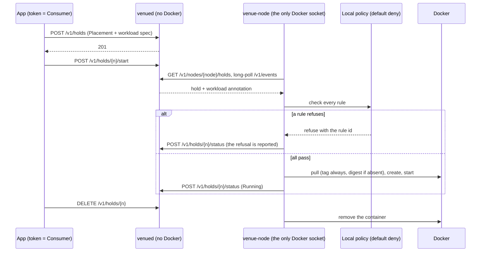

# 6. Venue

> [!info] State
> **Venue Kit** and `venued`: **alpha**. About 31k lines and 489 tests upstream (11 November 2026). Not published. The name is provisional.
>
> **The executor `venue-node`**: **Built**. It passes a 133-check exit test on two platforms. It needs **three unmerged venue-kit patches**, runs a **single node only**, has **no signed placements or grants**, and speaks plain HTTP.
>
> **Multi-node**: built and reviewed only against a simulated cluster. The latest independent review judged it not yet ready for a machine that hosts real services.

Venue is the directory, scheduler and ledger for **every place work can run**: a machine, a VM, an API provider, a rentable cloud pool, a peripheral behind a host. **It does not run the work.** Its own design says "it is not the executor". The piece that runs work is the node agent.

## The model: Kubernetes' vocabulary, on purpose

Venue Kit uses the **Kubernetes Resource Model** rather than a new format: `Node`, `Endpoint`, `NodePool`, `ContractClass`, `ContractClaim`, `Placement` and `Budget`, in the API group `node.slashbuilder.com/v1alpha1`, with `PriorityClass` and `Lease` accepted verbatim. Kubernetes (and DRA, Karpenter) is treated as the standards body: its names and semantics are followed unless a divergence is recorded with a reason. The API group is deliberately **not** named after the Kit, so a rename touches one constant.

### Every answer is Yes, No or Unknown

An *Unknown* says what would settle it. Nothing is trusted because a document says so:

- Each manager writes **its own observation**. The effective view is computed on read and keeps disagreements visible.
- Work that carries data classes needs **both a use grant and the data owner's egress grant**, or the answer is Unknown.
- Venue ships **no data about any estate**. Each install builds its own registry as plain YAML on the machine (`venue init`, `venue probe-local --save`).

### Keeping a machine's description alive

`venue pull` asks each machine over ssh to run `venue probe-local` (CPU, memory, disk, GPUs with live free memory, sound cards, container runtimes; Linux, macOS, Windows). It records an observation and a heartbeat. A machine that stops answering goes **Ready, then Unknown**. Containers are deliberately **not tracked**: workloads are another layer's job.

## `venued`: the shared registry

`venued` (19 October 2026) lets several programs, on one machine or many, share one registry.

- **JSON over HTTP.** A **bearer token per app** selects a **manager**, so the existing caps, principals and grants apply.
- **Verbs:** plan, hold, start, renew, release.
- **A long-poll event feed.** Every write is an event at once.
- **Loopback by default.** With `--tls` it serves the network with a self-signed certificate that each client **pins by fingerprint**, like an ssh host key. No certificate authority.
- **Tokens** are `vnt_` plus 256 random bits. Only the SHA-256 is stored; the file is mode 0600.

### Managers and classes

A manager has a class in `authority.yaml`: **Authoritative**, **NodeAgent**, **Consumer**, **Observer**, **Untrusted**. A manager absent from the file is Untrusted and gets a 401. There is no CLI to add a manager; you append a line to `authority.yaml`.

### Holds

A **hold** is a reservation. An app places one with a **Placement** document, **starts** it, **renews** it, and **releases** it. A start does not run anything by itself; it records that the hold is in use. Something else follows the feed and does the work.

## The executor: `venue-node`

`venue-node` is the first form of the node agent. It lives in `benixos/benixos` as a Rust crate of about 16.8k lines. `docker compose up -d` on one machine gives you **`venued`** and **`venue-node`**; a hold followed by a start runs a container, **but only if a local, default-deny policy allows it**.

### The shipped design in six lines

1. The executor authenticates as the **NodeAgent** manager `node:<host>` that `venue init` already writes. Its token is minted once by the bundle's `init` step.
2. It requires the **patched** `venued`: patch A1 (`GET /v1/nodes/{name}/holds`) returns each hold with its workload annotation; A3 (`POST /v1/holds/{name}/status`) lets the executor report back; A2 adds the node to `hold.status` events. Without the patches `venue-node run` refuses to run.
3. **What to run** is the JSON in the Placement annotation `workload.benixos.io/spec`. A start is the order to run it.
4. Every started hold passes the executor's **local, default-deny policy** before anything reaches Docker ([Grants and enforcement](07-grants-and-enforcement.html)).
5. The executor reports **Running, Failed or Exited** per hold.
6. It is the **only process with the Docker socket**, acts only on containers that are its own (managed label, this node, **and this install's random instance id**), and keeps enforcing leases across restarts from a small persisted state.

### Behaviour that was verified in a real run

On native Ubuntu 26.04 (amd64) with Docker Engine 29.7.2: **133 checks, 0 failed**, all healthy in 7.5 s, Docker state identical before and after. The same suite passed on macOS Docker Desktop (arm64), on earlier code. Among the checks:

- Nothing listens off loopback.
- A started hold runs with labels, limits, no capabilities, a read-only root, uid 10100, on a user-defined `icc=false` network.
- Privileged mode, `docker.sock`, a disallowed image, traversal and a plain relative mount are all refused with the exact rule id, and nothing is created.
- An executor stop, SIGKILL or `down` then `up` adopts the same container.
- With `venued` stopped, a restarted executor stops the workload when its *persisted* lease ends, not before.
- No token appears in any log or `docker inspect`.

### What is not verified

Debian 12 itself, native Linux on arm64, rootless Docker, SELinux, the optional `socket-proxy` profile (never started), the lease-end stop and startup sweep *under a refusal* against a real `venued`, workload egress, and any CI beyond what was set up on 12 November 2026. Details in the repo README.

### Known limits

- **The Docker socket is root on the host.** The default-deny policy is the control; a flaw in the executor is host root.
- **Workload egress is open**; **workloads have no storage** (mounts were removed, not hardened).
- **The executor token never expires** and there is no rotation (finding L5, open).
- **Single node only. No signed placements or grants yet. Plain HTTP.**
- **`down -v` orphans running workloads.** There is a `reap-orphans` tool, tested against stubs only.

## Rulings that shape Venue

| Ruling | Content |
|---|---|
| Node agent location | The node agent lives **beside** `venue-kit` in the system tree, not inside it. It holds root-equivalent access; `venue-kit` is a generic Apache-2.0 Kit. |
| Placement authority | **Venue decides *where*; the agent decides *whether*,** from owner-signed grants. Fourteen amendments from the protocol and security reviews are proposed and not yet confirmed. |
| 11 November 2026 | **Venue first**, as the wrapper in front of Docker on localhost, going straight to Docker (`bollard`) and **not through `substrate-kit`**, which lacks ports and volumes in the local checkout. |
| 11 November 2026 | Keep `venued` as the API and put the Docker driver in a **separate `venue-node` process**, so the Docker socket stays out of the process that serves a token-protected HTTP API on the LAN. |

## Several nodes: the weekend build

A build-out on 14 November 2026 aimed to run Venue on every lab machine in one cluster by the end of the weekend. The design is a **star**: one registry host, an executor on every node, **outbound-only** from the nodes, and **mutual TLS** on the one inbound port.

Five tracks ran in parallel:

- a heartbeat route and rebased venue-kit patches;
- a stunnel mTLS link and registry overlay;
- an operator CLI (`venue-ctl`) and a lease keeper (`venue-keepalive`);
- a simulated-cluster harness (Docker-in-Docker nodes);
- a host inventory with a dry-run rollout kit.

**As of the evening of 15 November 2026:**

- Two independent security review rounds are done. The second judged the stack **not yet ready for a machine that hosts real services**. The findings went back for another pass.
- The integration branch merged cleanly (about 20,000 lines); the 3-node simulated suite is still running.
- **The realistic outcome** is a built, reviewed, simulated-cluster-proven stack plus a rollout kit, **not live nodes**. Registry host choice, CA key custody, firewall rules and token handling stay with the project's owners.
- GPU placement cannot be validated until the build machine's Docker has an NVIDIA runtime.

## Next

[7. Grants and enforcement](07-grants-and-enforcement.html)
