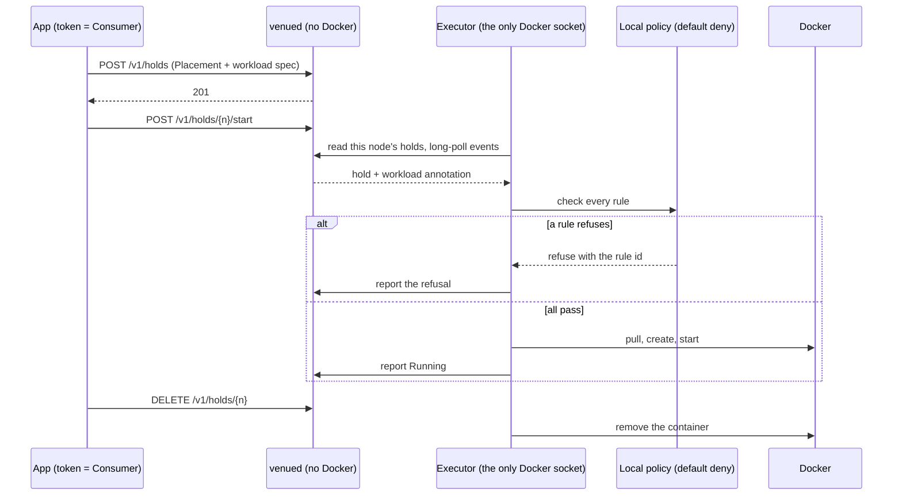

# 6. Venue

> [!info] State
> **Venue Kit** and `venued`: **alpha**. The name is provisional.
>
> **The executor:** **Built** for a single node. It has no signed placements or grants and speaks plain HTTP.
>
> **Several nodes:** built and reviewed only against a simulated cluster.

Venue is the directory, scheduler and ledger for **every place work can run**: a machine, a VM, an API provider, a rentable cloud pool, a peripheral behind a host. **It does not run the work.** The node agent does.

## The model

Venue uses the **Kubernetes resource model** instead of a new format: `Node`, `Endpoint`, `NodePool`, `ContractClass`, `ContractClaim`, `Placement` and `Budget`, under a versioned `v1alpha1` API group, with `PriorityClass` and `Lease` accepted verbatim. Kubernetes names and semantics are followed unless a divergence is recorded with a reason.

### Every answer is Yes, No or Unknown

An *Unknown* says what would settle it. Nothing is trusted because a document says so.

- Each manager writes **its own observation**. The effective view is computed on read and keeps disagreements visible.
- Work that carries data classes needs **both a use grant and the data owner's egress grant**, or the answer is Unknown.
- Venue ships **no data about any estate**. Each install builds its own registry as plain YAML.

### Keeping a description alive

`venue pull` asks each machine over ssh to run `venue probe-local` (CPU, memory, disk, GPUs with live free memory, sound cards, container runtimes) and records an observation and a heartbeat. A machine that stops answering goes **Ready, then Unknown**. Containers are not tracked; workloads are another layer's job.

## `venued`: the shared registry

`venued` lets several programs, on one machine or many, share one registry.

- **JSON over HTTP.** A **bearer token per app** selects a **manager**, so caps, principals and grants apply.
- **Verbs:** plan, hold, start, renew, release.
- **A long-poll event feed.** Every write is an event.
- **Loopback by default.** With `--tls` it serves the network using a self-signed certificate that each client **pins by fingerprint**, like an ssh host key. No certificate authority.
- **Tokens** are 256 random bits; only the SHA-256 is stored.

A manager has a class: **Authoritative**, **NodeAgent**, **Consumer**, **Observer** or **Untrusted**.

### Holds

A **hold** is a reservation. An app places one with a **Placement** document, **starts** it, **renews** it and **releases** it. A start records that the hold is in use. It runs nothing by itself.

## The executor

The executor is the first form of the node agent. It follows `venued`'s event feed and runs containers, **but only if a local, default-deny policy allows it.**

### Design

1. The executor authenticates as the **NodeAgent** manager for its node. Its token can read the holds on that node and report status. It cannot place or start anything.
2. **What to run** is the JSON in the Placement annotation `workload.benixos.io/spec`. A start is the order to run it.
3. Every started hold passes the executor's **local, default-deny policy** before anything reaches Docker ([Grants and enforcement](07-grants-and-enforcement.html)).
4. The executor reports **Running, Failed or Exited** per hold.
5. It is the **only process with the Docker socket**. It acts only on containers that are its own: managed label, this node, **and this install's random instance id**.
6. It keeps enforcing leases across restarts from a small persisted state. It never stops workloads just because it restarted.

### Behaviour

- Nothing listens off loopback.
- A started hold runs with labels, limits, no capabilities, a read-only root and a non-root uid, on a user-defined network with inter-container traffic disabled.
- Privileged mode, `docker.sock`, a disallowed image, traversal and a plain relative mount are refused with the exact rule id, and nothing is created.
- A restarted executor adopts the same container.
- With `venued` stopped, a restarted executor stops a workload when its *persisted* lease ends, not before.
- No token appears in any log or `docker inspect`.

### Limits

- **The Docker socket is root on the host.** The default-deny policy is the control.
- **Workload egress is open**, and **workloads have no storage**.
- **The executor token never expires.**
- **Single node. No signed placements or grants. Plain HTTP.**

## Several nodes

The design is a **star**: one registry host, an executor on every node, **outbound-only** connections from the nodes, and **mutual TLS** on the one inbound port. It also includes a heartbeat route so a node can refresh its own lease, an operator CLI, and a lease keeper that renews holds and re-places work before the lease cap. It has been built and reviewed against a simulated cluster of Docker-in-Docker nodes, not against live machines.

## Next

[7. Grants and enforcement](07-grants-and-enforcement.html)
