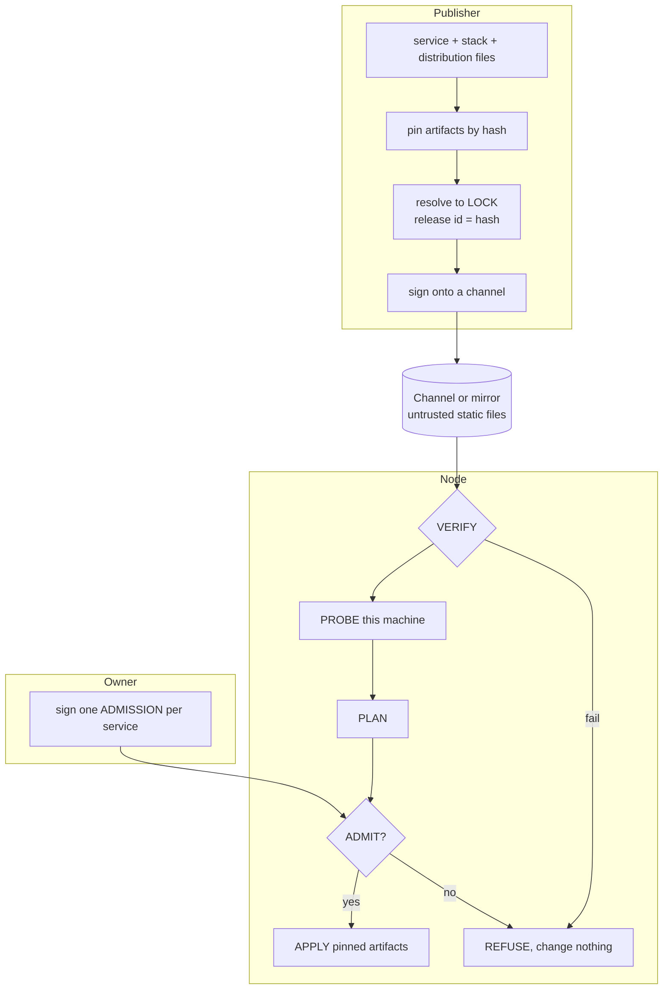

# 9. Distribution

> [!info] State
> **Partial.** A pre-beta prototype exists. It uses throwaway keys only, has not been audited, has never run against a hardware key, uses no TLS, and has no separate fetcher process.

A **distribution** is a named bundle of services, for example a small household: media, home automation, a DNS filter. Think of it as an **app store with a notary**.

A publisher builds and signs a release. It lands on a **channel** (nightly, beta, stable), which is just a folder of files that any web server or USB stick can serve. Each node pulls the release, checks everything, works out what can run on *itself*, and starts only what **the owner personally approved**.

Nothing the publisher says can approve anything for the owner.

## Who does what

| Who | Role | Holds |
|---|---|---|
| **Publisher** | Writes the distribution, builds artifacts, signs the release | Channel signing keys, one set per channel |
| **Owner** | Decides which services may run; can roll back | One SSH key; its public half is pinned on every node |
| **Channel or mirror** | Serves static files; **not trusted at all** | Nothing |
| **Node** | Runs the distribution | The owner's public key, a pinned root, a memory of what it has seen |

## The seven steps

1. **Describe.** Three small text files: the **services** (and how each is delivered: container image, binary or UI), the **stack** (required, recommended or optional), and the **distribution** (which kinds of machine it supports). Every artifact is **pinned by hash**, never "latest".
2. **Compile to a lock.** A resolver produces one **lock**, the complete self-contained plan. Its fingerprint, the **release id**, is a hash of its contents.
3. **The owner approves.** For each service the owner signs a small **admission** with an SSH key. No admission, no run.
4. **Publish.** The publisher signs the release onto a channel. **Each channel has its own signing keys**, so a key that is online for nightly can never sign stable.
5. **The node verifies.** Signatures meet the threshold; metadata is not expired; the release is **not older** than anything already seen; every file matches its hash and length; the lock hashes to the id claimed; the lock is structurally sound. Any failure leaves the machine as it was.
6. **Plan, check, apply.** The node measures itself, the planner decides what runs *here*, and admissions are checked against every planned service. Containers start by digest, read-only, with no capabilities and no network. Binaries run only if the operator allows.
7. **Update and roll back.** A new release goes through the same path, and only what changed restarts. **Going backwards needs a record signed by the owner**, tied to this node and used once.

## What an attacker gets

| Attack or accident | Result |
|---|---|
| Unsigned, tampered, truncated or oversized file | Refused; nothing changes |
| An old release replayed, or a stale mirror | Refused |
| Expired metadata | Installs blocked; **what is running keeps running** |
| **A stolen publisher key** | The thief can publish but **cannot make anything run**: that needs the owner's admission |
| A lock that hides or doubles a service | Refused as malformed |
| A file on the node edited behind its back | Detected and refused |
| Power cut mid-update | Old state intact; retry works |

## Limitations

- **Every key is a throwaway.** Offline roots on hardware tokens and an owner key held on a device are not built.
- **There is no separate fetcher process**, and the HTTP source is a test stub.
- **Runtime enforcement is not built.** Nothing reads the admitted ceiling at run time.
- **Binary services run as the node's own user**, without a sandbox.
- **Not yet exercised:** more than one node, placement by Venue, and the real gateway and grants.
- **The node's own update** (the agent and claim sit outside the distribution) has no channel.

## Next

[10. Data and identity](10-data-and-identity.html)
