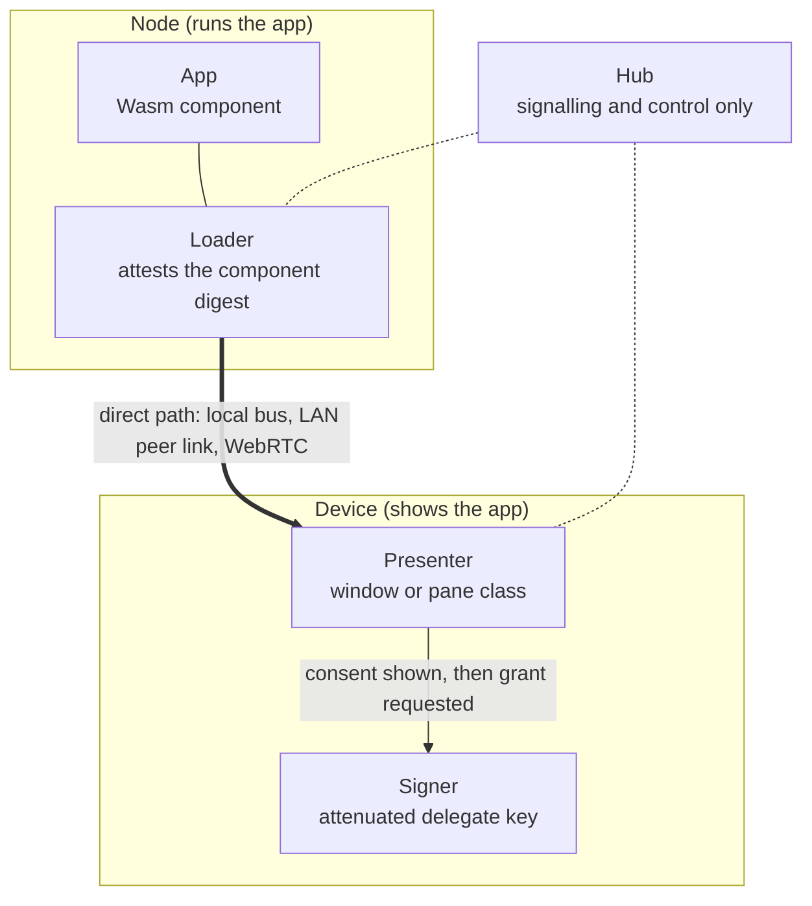

# 13. Presenters

> [!info] State
> **Draft.** The design is settled in outline. A local prototype has exercised it end to end: a sandboxed app, a loader, a presenter core, a separate signer and a software renderer. **No presenter ships yet.**

Apps do not draw. They describe their interface in terms of meaning, and a **presenter** renders it. The presenter owns widgets, layout, text editing, accessibility, theming, the window tree, focus and input routing. It also mediates the clipboard, drag and drop, and capture.

This is the BeOS `app_server` ownership model, cut at semantics instead of drawing commands.

## The presenter spec

The **presenter spec** is open and owned by BenixOS. It defines what an app may say and what a presenter must do with it.

- **Semantic only in v1.** Apps send a tree of meaningful elements, not pixels. Canvas and surface tiers are deferred extensions, each needing its own review.
- **Scenes, not windows.** A window-class presenter maps a scene to an OS window. A pane-class presenter maps it to a navigation destination.
- **Responsive layout is mandatory**, so one tree serves both classes.
- **Conformance profiles** are negotiated per mounted view: Core first, then Canvas, Surface and Windowing.
- **Text editing, scrolling and list pulls happen inside the presenter.** The app sees commits.

The **headless presenter core** is Apache-2.0 and shared by every presenter. It is a library with a small C interface, so a shell in any language can host it.

## Presenter classes

| Class | Shape | Examples |
|---|---|---|
| **Window class** | Multi-window; owns the window tree | A desktop shell on Linux (as a compositor), macOS and Windows |
| **Pane class** | A single pane; compact layout with a back bar | A phone or a single-pane desktop view |

**Casement** is the reference window-class presenter. It is a server, not a Kit. A pane-class presenter must be implementable from the presenter core alone.

## What goes on the wire

Almost all of the spec is application-layer payload. It adds **no Hearth envelope variant**, so the count stays at 24.

- **Kinds are namespaced and versioned**, for example `benixos.list/1`. Each carries a `fallbacks[]` chain, unknown properties are ignored, and a *must-understand* flag marks kinds that cannot be skipped. A consent view is must-understand and never falls back.
- **Never on Hearth:** GPU textures, file descriptors, handles, encoded video, fonts and glyph atlases, embedded bitmaps, raw pointer streams, and patches retained as history.

A prototype found requirements the spec must state:

| Requirement | Why |
|---|---|
| **The tree's wire form is non-recursive**: a flat pre-order list with explicit depth | A recursive decoder can be crashed by a deeply nested frame far below the size cap. Size caps alone do not protect |
| **Every patch and event carries a base revision** | The presenter can detect a gap |
| **A credit window**, counted in patches and bytes | The app cannot outrun the presenter |
| **Snapshot, then deltas.** Resync is re-requested until it succeeds, and no credit is granted while out of sync | A single lost resync request otherwise livelocks a lossy link |
| **Snapshot retries use stop-and-wait with exponential backoff and jitter** | A jitterless retry loop makes congestion worse |
| **Input is idempotent**, with a client sequence number, and some classes are droppable | Retries and drops must be safe |

## Where the traffic flows

The **hub** carries signalling and low-rate control: session control, presence, push-wake, grant requests and rendezvous. **Interactive view traffic never rides the hub.** It takes a direct path:

| Where | Path |
|---|---|
| On the box | The local bus |
| On the LAN | A mutually authenticated peer link |
| Across the WAN | A WebRTC data channel, with a relay as fallback |

All three carry the same sealed envelopes. A hub is tuned for household state, not for interactive streams.

If no direct path exists, the presenter shows the **last cached snapshot, read-only, with a visible "no direct connection" state**. A class of view that cannot degrade this way is refused.

**Transport is never an authorization input.** A direct path bypasses a hub's revocation check, so authority comes only from grants.

Work remaining on the wire is additive: carrier profiles for the peer link and the data channel, a device-key peer-authentication arm on the session hello, and a push-wake registration field. The first scope is the LAN and BenixOS; the WAN comes later.

## The trust path

An app must never emit anything that a presenter treats as trusted. Consent is therefore built from outside the app:

1. The loader or node **signs a grant request**: "component D on node N requests typed resource R, these operations, this TTL".
2. The presenter verifies it against the roster, checks the owner's admission, and parses R **once** to a canonical value.
3. The presenter renders the consent text **from its own template, in reserved chrome**.
4. After a **fresh user gesture**, a separate **signer** issues the grant.

Minimums for the spec:

- The presenter holds only an **attenuated delegate key**, inside a **separate signer** that re-derives the consent text from the grant bytes.
- The **consent kind is reserved.** Any app tree containing it is refused.
- **App identity is the loader-attested component digest**, never the descriptor's title, shown in chrome an app cannot draw.
- Every cross-node view stream carries an **origin binding** (node key, component digest, placement id, nonce) signed inside the sealed payload.
- **Clipboard, drag and drop, and capture are one-shot grants** bound to a user gesture.

Each minimum has a conformance fixture. For example, a fake consent descriptor from an app must be refused, and a recording mock proves the signer was never called.

The open window shell must be a **complete, conformant consent implementation**. Consent correctness cannot depend on any other presenter.

### The trusted display path

A presenter that is fully compromised can lie about what it displayed. The defence is the host's own secure UI. The spec states what it requires of that path, and **a host without one is a reduced-trust host.**

### Known gaps

- **Chrome shows who is asking, not what.** An app can still draw a convincing "enter your password" screen that passes validation. The spec needs a rule: presenter-owned secret inputs, or a visible warning on app-owned fields.
- **The signer and the presenter share one verification function** in the prototype. Production needs independent implementations.

## Next

[14. The security model](14-security-model.html)
